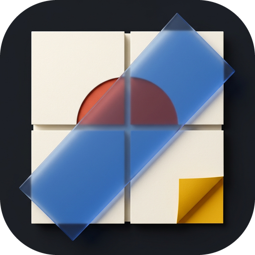

# 页光 Koma

<p>
  
</p>

**中文** | [English](README_EN.md)

**页光 Koma** 是一款面向 Windows、Android 平板与手机的开源本地/WebDAV 与在线漫画阅读器，取名自日语漫画“分格（Koma）”概念，专注多源漫画阅读、平板竖单横双自适应分屏阅读与纯粹无干扰体验——无广告、无过期弹窗、无任何第三方统计分析。

> 包名：`com.arkreader.comic` · 最低支持：Android 9.0 (API 28) · 目标版本：Android 14 (API 34)

---

## 核心特性

### 1. 内置 Venera 兼容动漫源 & 作品集系统
- **内置在线动漫源 + 标准 Venera 源仓库订阅**：
  - 内置轻量无依赖 JS 运行时 (`WebView` / Windows `WebView2` + 原生 Cookie/AES/Hash 桥接)，直接兼容 Venera / Venera-Next 标准 `ComicSource` JS 脚本与 `index.json` 源仓库订阅。
  - **内置 65 个漫画源**，包括再漫画、快看漫画、禁漫天堂与 Komiic。Komiic 的阅读章节需要源账号，可在「设置 → 漫画源与登录」登录。
  - 首页记住上次漫画源，栏目横排，滚动自动续页。在线收藏与本地书架分别管理；已缓存的封面和简介可离线查看。
- **作品集与隐私加密**：
  - 自定义作品集分组，支持从「本地全部」隐藏隐私作品集。
  - 支持 **数字 PIN 密码锁** 与系统 **`BiometricPrompt` 指纹/生物识别锁**（可选切出后台 2 秒自动重锁）。

### 2. 多来源本地/云端仓库与格式支持
- **本地目录 (SAF)**：通过 Android Storage Access Framework (`OpenDocumentTree`) 持久化授权访问内置存储与 SD 卡目录，支持自定义封面文件名、在相册屏蔽扫描 (`.nomedia`)。
- **WebDAV 网盘仓库**：内置轻量级 WebDAV 客户端，支持 Basic 认证连接测试与远程浏览扫描。
- **多格式解析引擎**：
  - 图片文件夹 (`jpg` / `jpeg` / `png` / `webp` / `bmp` / `gif`)
  - 压缩包漫画 (`ZIP` / `CBZ` / `EPUB`)
  - PDF 漫画（基于 Android 原生 `PdfRenderer`，支持缩放倍率调节）

### 3. 沉浸式平板阅读器与悬浮胶囊 UI
- **全屏沉浸与透明状态栏**：阅读时彻底隐藏系统状态栏与导航栏，点击屏幕中央呼出菜单时才以透明状态栏渐变浮层显示系统时间与章节标题，最大化阅读视野。
- **悬浮圆角胶囊菜单 + 跨页匹配胶囊**：采用居中半透明暗色圆角胶囊控制栏（含进度条、上/下一章切换、阅读设置、书签与章节目录）以及右上方 **「更改跨页匹配」** 悬浮按键。
- **竖屏单页 / 横屏自动双页 (`AUTO_LANDSCAPE`)**：竖屏自动单页、横屏自动双页并排拼接并保留当前进度；支持预检测原生跨页宽图，避免已合图二次拼接。
- **高度可定制阅读配置**：垂直连续滚动、水平从左到右 (LTR)、水平从右到左 (RTL / 日漫)、多种点击翻页区、音量键翻页、智能白边裁剪、空白页跳过、背景色及自定义分页参数。

### 4. 漫画翻译与外观

在设置中选择本地背景壁纸，或启用带高光、半透明边缘和背景柔化的液态玻璃材质。

1. 在「设置 → 漫画翻译」填写漫画翻译服务地址。「服务端默认」沿用 [manga-image-translator](https://github.com/zyddnys/manga-image-translator) 的图片接口。
2. 使用自定义模型时，部署支持流式用户模型参数的 [manga-translator-ui](https://github.com/hgmzhn/manga-translator-ui)，在应用内登录翻译服务，再选择「自定义文本模型」或「自定义视觉模型」。填入模型 API 地址、模型 ID 和需要的 API 密钥。文本模型翻译 OCR 提取的文字，视觉模型需要支持图片输入。
3. 阅读时轻点画面中央显示工具栏，选择「翻译」后，当前页才会发送至所填的漫画翻译服务。由该服务调度模型并输出译图，选择「原文」可恢复原图。

左上角头像打开个人页，可更换本地头像、查看今日、本周和各作品的阅读时长。问题反馈先在应用内预览，经确认后打开 GitHub Issues，由用户登录并提交。切换界面或切回漫画源时，浏览列表及位置保存在会话中。


---

## 项目结构

```text
koma-comic/
├── app/
│   ├── build.gradle.kts
│   └── src/
│       ├── main/
│       │   ├── AndroidManifest.xml
│       │   ├── assets/                             # Venera JS 兼容垫片与内置开源动漫源脚本
│       │   ├── java/com/arkreader/comic/
│       │   │   ├── ArkReaderApp.kt                 # 应用入口与全局单例 (DB / Prefs / Cache / VeneraRuntime)
│       │   │   ├── data/                           # 数据模型、SQLite DatabaseHelper 与配置持久化
│       │   │   ├── engine/                         # Venera JS 运行时、源仓库订阅、本地/WebDAV/PDF/ZIP 引擎
│       │   │   └── ui/                             # 首页动漫源/本地图库、源管理、详情页、阅读器、作品集、仓库与设置界面
│       │   └── res/                                # 平板/手机自适应布局、主题配色与图标资源
│       └── test/java/com/arkreader/comic/
│           └── CoreEngineTest.kt                   # 核心引擎与源解析单元测试
├── windows/                                        # Windows 原生桌面端 (WPF DirectX + Per-Monitor V2 高清矢量渲染 + 后台 JS 引擎)
│   ├── Program.cs
│   ├── app.manifest
│   └── build-windows.ps1
├── build.gradle.kts
├── gradle.properties
├── settings.gradle.kts
└── LICENSE
```

---

## 编译与安装

### Windows 原生桌面版

#### 环境要求
- Windows 10 / 11 (x64)，内置 .NET Framework 4.x 与 Microsoft Edge WebView2 运行时

#### 一键构建便携版
```powershell
powershell -ExecutionPolicy Bypass -File windows/build-windows.ps1
# 或通过 Gradle 任务：
gradle assembleWindows
```
输出目录：`build/windows/KomaComic-windows-x64/KomaComic.exe`  
发布压缩包：`build/release/KomaComic-v1.4.1-windows-x64.zip`

---

### Android 端环境依赖
- **JDK**: Java 17 或 Java 21
- **Android SDK**: Compile / Target SDK 34 (`platforms;android-34`, `build-tools;34.0.0`)
- **Gradle**: 8.7+

### 构建步骤

1. 在仓库根目录创建 `local.properties`，指定本机 Android SDK 路径（以 Windows 为例）：
   ```properties
   sdk.dir=D\:\\Android
   ```
2. 执行单元测试并编译 Debug APK：
   ```bash
   gradle testDebugUnitTest assembleDebug --no-daemon
   ```
   编译产物位于：`app/build/outputs/apk/debug/app-debug.apk`
3. 使用 ADB 安装到平板或手机：
   ```bash
   adb install -r app/build/outputs/apk/debug/app-debug.apk
   ```

---

## 开源协议

本项目基于 [MIT License](LICENSE) 开源。
