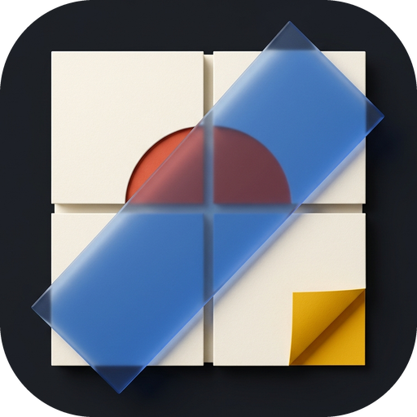

# KomaComic (漫格漫画)

<p>
  
</p>

[中文](README.md) | **English**

**KomaComic** is an open-source local and WebDAV comic/manga reader built for Android tablets and phones. Named after the comic panel (*Koma*), it focuses on local comic libraries, adaptive portrait/landscape double-page reading on large screens, and a clean, distraction-free experience—no ads, no expiration popups, and no third-party analytics or tracking SDKs.

> Package ID: `com.arkreader.comic` · Minimum SDK: Android 9.0 (API 28) · Target SDK: Android 14 (API 34)

---

## Features

### 1. Multi-Source Libraries & Format Support
- **Local Directories (SAF)**: Persistent Storage Access Framework (`OpenDocumentTree`) permissions for internal storage and SD cards, with optional `.nomedia` creation, custom cover filenames, and gallery-hiding toggles.
- **WebDAV Libraries**: Built-in lightweight WebDAV client (Basic Auth and connection testing) to scan and stream remote comic folders, archives, and PDFs.
- **Supported Formats**:
  - Local / remote image folders (`jpg` / `jpeg` / `png` / `webp` / `bmp` / `gif`)
  - Archive & e-book comics (`ZIP` / `CBZ` / `EPUB`)
  - Native PDF rendering via Android `PdfRenderer` with adjustable render scale

### 2. Tablet-First Comic Reader
- **Portrait Single Page / Landscape Double Spread (`AUTO_LANDSCAPE`)**:
  - Automatically displays single pages in portrait and side-by-side double-page spreads in landscape while preserving your current reading position on rotation (also switchable anytime to Single Page, Always Double Page, or Split Double Page).
  - Pre-scans local page dimensions so already-wide spread images stay intact instead of being merged twice.
- **Quick Overlay Action Pills**:
  - **Change Spread Pairing (`更改跨页匹配`)**: Built directly into the reader UI overlay to toggle first-page pairing parity (`Single Start` vs `Paired Start`), fixing misaligned two-page spreads in one tap without losing your page.
  - **Merge Direction Toggle**: Instantly switch double-page ordering between `Left → Right` and `Right → Left` (Manga).
- **Customizable Per-Comic Reader Profiles**:
  - Reading modes: Vertical continuous scroll, Horizontal LTR, Horizontal RTL
  - Gestures & hardware keys: Pinch-to-zoom, double-tap zoom, customizable tap zones (Left/Right or Diagonal), swapped tap directions, volume-key page turns, haptic feedback
  - Image & display tools: Smart white-margin trimming (adjustable threshold & 10% edge safety), blank-page detection, horizontal padding, background colors (Black / Dark Gray / Light Gray / White), keep-screen-on, and bookmarks

### 3. Bookshelves, Privacy Lock & Themes
- **Adaptive Tablet & Phone Layout**: Uses a `NavigationRail` sidebar and multi-column grid on tablets (`>= 600dp`), switching automatically to a `BottomNavigationView` on phones.
- **Bookshelf Management & App Lock**: Create custom bookshelves, hide private shelves from the Home "All" tab, and protect shelves with a **Numeric PIN** or system **`BiometricPrompt` fingerprint lock** (with optional 2-second background quick relock).
- **Natural Sorting & CJK Search**: Natural numeric ordering for volumes/chapters (e.g. `Ch. 2` before `Ch. 10`), case-insensitive filtering, and Traditional/Simplified Chinese character folding.
- **Theming & Cache Control**: System / Light / Dark night modes, 8 accent color themes, 4 library density presets (Large / Medium / Small grid & List), and one-tap cover/archive cache cleanup.

---

## Project Structure

```text
koma-comic/
├── app/
│   ├── build.gradle.kts
│   └── src/
│       ├── main/
│       │   ├── AndroidManifest.xml
│       │   ├── java/com/arkreader/comic/
│       │   │   ├── ArkReaderApp.kt                 # Application entry point & singletons (DB / Prefs / Cache)
│       │   │   ├── data/                           # Models, SQLite DatabaseHelper & SharedPreferences
│       │   │   ├── engine/                         # Scanner, WebDAV, PDF/ZIP/SAF sources, image & spread engine
│       │   │   └── ui/                             # Main library, detail view, reader, warehouse & settings UIs
│       │   └── res/                                # Tablet/phone responsive layouts, themes & icon assets
│       └── test/java/com/arkreader/comic/
│           └── CoreEngineTest.kt                   # Core engine unit tests
├── build.gradle.kts
├── gradle.properties
├── settings.gradle.kts
└── LICENSE
```

---

## Build & Installation

### Prerequisites
- **JDK**: Java 17 or Java 21
- **Android SDK**: Compile/Target SDK 34 (`platforms;android-34`, `build-tools;34.0.0`)
- **Gradle**: 8.7+

### Steps

1. Create `local.properties` in the project root pointing to your Android SDK (Windows example):
   ```properties
   sdk.dir=D\:\\Android
   ```
2. Run unit tests and build the Debug APK:
   ```bash
   gradle testDebugUnitTest assembleDebug --no-daemon
   ```
   Output APK: `app/build/outputs/apk/debug/app-debug.apk`
3. Install onto a connected tablet or phone via ADB:
   ```bash
   adb install -r app/build/outputs/apk/debug/app-debug.apk
   ```

---

## License

Released under the [MIT License](LICENSE).
